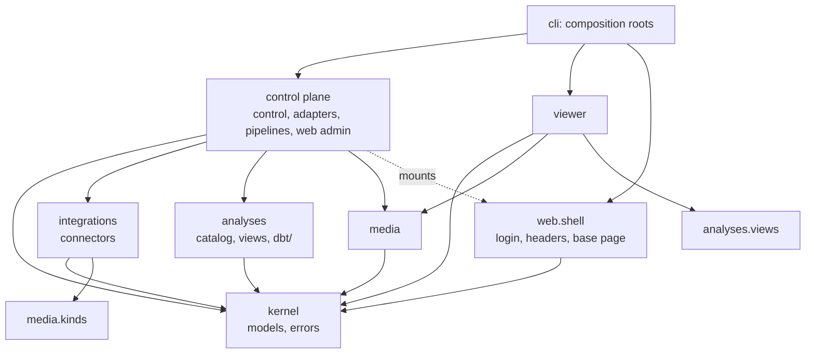
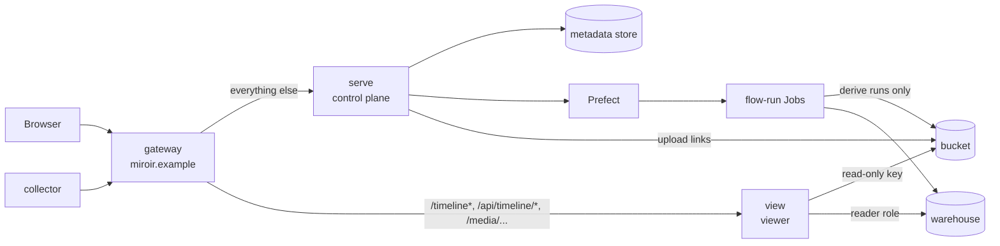

# Miroir is split into parts inside one distribution

Status: accepted, 2026-11-25, with pull request #58. Each
step below cites it. [Architecture](../architecture.md) describes the code as it
is and changes with each step.

Miroir becomes six parts with one concern each, plus a thin web shell, still in
one repo, one distribution and one image: kernel, connectors, analyses, media,
the control plane (`src/core` renamed `src/control`) and the viewer. The viewer
runs as a process of its own. New timeline features are paused while the code
moves.

## Why

Concerns are mixed today:

1. The collector's media route depends on the viewer. `src/web/app.py:38-44`
   imports the timeline, and the `/media/...` route (`src/web/app.py:532-568`)
   asks `media_withheld`; a slow or down warehouse makes files unservable (503,
   504).
2. The viewer decides media visibility and knows connector details:
   `media_withheld` is in `src/core/timeline.py:272-321`, and
   `src/core/timeline.py:182-186` hardcodes the `timeline` package, the `screen`
   and `messages` roles and the `screenshots` and `attachments` kinds.
3. Sources are hardcoded in three places: `src/core/timeline.py:351-353`
   (`SOURCES` plus messages), `src/web/static/timeline.js:71-75` (one element
   per lane) and `dbt/models/timeline/events.sql:16` (the list given to
   `timeline_remove_foreign`). A new source edits the reader, the JavaScript,
   the templates and the package's dbt.
4. The viewer finds its schema through the build's naming function
   (`src/core/timeline.py:26`, `analysis_plan`). The dependency is legitimate;
   the contract is implicit.
5. Every control-plane page computes viewer state: `timeline_links` runs on
   every page (`src/web/app.py:746-762`), `create_app` takes the timeline
   (`src/web/app.py:170`) and mounts the viewer's routers
   (`src/web/app.py:796-804`).
6. The viewer widens the content security policy for every response:
   `img-src 'self' blob:` (`src/web/app.py:70`).
7. The control plane's facade carries viewing-only media reads:
   `media_view_url`, `media_thumbnail` and `media_image`
   (`src/core/service.py:234-255`).
8. S3 sits beside the Prefect adapter but serves only media, and the boundary
   test needs an allowance for `pipelines` to import it
   (`tests/test_boundaries.py:14`, `src/pipelines/miroir.py:20,105`).
9. Media imports the control plane: `src/core/derive.py:29-46` imports
   `ResolvedConnection`, `ResolvedMiroir` and `MetadataStore`, and the queue's
   tables are in `src/core/operations.py:215-249`.
10. Every flow run holds the bucket key: `src/pipelines/miroir.py:105` builds
    the object store for any run, so a GitHub sync can read and write the whole
    bucket ([Media](../miroir/media.md)). It is the largest real exposure.
11. One process holds almost every credential: metadata read-write, the master
    key, Prefect, the warehouse reader and the media key. A bug in a timeline
    query runs next to the master key.
12. The boundary test special-cases single modules (`_TIMELINE`, `_DECODER`,
    `_DERIVE` in `tests/test_boundaries.py:19-31`): parts living inside
    `core`.

Two couplings stay: derive as an operation kind
(`src/core/runner.py:424-427,1112-1210`), because the control plane schedules
media work; and the timeline's `reader_role` parameter
(`src/analyses/catalog.py:50-99`), because the build grants what the viewer
reads.

## The parts

Everything stays under `src/`. `adapters` and `pipelines` are not parts of their
own: they belong to the control plane.

| Part | Its concern | Owns | May import | Never imports |
| --- | --- | --- | --- | --- |
| kernel (`src/kernel/`) | The shared vocabulary | `models.py` (StrictModel, Identifier, DatabaseIdentifier, SecretKey) and `errors.py` (OperationError, Unavailable, Timeout) | The standard library, pydantic | Any other part. Configuration stays out: it imports the connector registry (`src/core/config.py:24-25`) |
| integrations (`src/integrations/`) | One source each | The connectors and the registry | kernel, `media.kinds` | Anything else |
| analyses (`src/analyses/`, `dbt/`) | Packages and their models | The catalog, the dbt project, view declarations (`views.py`: views, lanes, plugin names, data only) | kernel | control, media, viewer, dlt |
| media (`src/media/`) | Files that rows point at | `store.py`, `s3.py`, `names.py`, `links.py`, `uploads.py`, `queue.py` (`media_pending`, `media_backfills` and their repository), `derive.py`, `decoder.py` (was `thumbnails.py`), `decoder_checks.py`, `config.py` (MediaConfig), `kinds.py` (MediaKind), the `media_objects` writer, `MIROIR_MEDIA_*`. No routes | kernel | control, viewer, the connector registry, fastapi, prefect |
| control plane (`src/control/`, `src/adapters/` with Prefect only, `src/pipelines/`, `src/web/` admin, `src/cli/`) | Configuration, connections, runs, Prefect, artifacts, secrets, the metadata store, builds, the ingest API, the setup interface | `miroir.json`, every metadata table but the two media ones, `MIROIR_SECRET_KEY`, Prefect credentials, delivery tokens, metrics | kernel, integrations, analyses, media | The viewer; only `cli` composes it |
| viewer (`src/viewer/`) | Reading the warehouse and showing it | The reader, `/timeline*`, `/api/timeline/*`, the `/media/{connection}/{kind}/{key}` view route and its withheld check, the plugins `scrubber` (screen) and `thread` (conversations), its templates and static files, the reader credentials | kernel, media (the view side), `analyses.views` | control, adapters, pipelines, integrations, web, dlt, prefect, Pillow, boto3 |
| web shell (`src/web/shell.py`) | One HTTP surface | Token and session checks (today `authorize`, `src/web/app.py:187-206`), security headers with a policy per mounted part, `/login`, `/logout`, `/static`, the base template, a navigation registry in place of `timeline_links` | kernel | Any other part |
| collector (`collector/`) | Unchanged | | | |

The viewer's settings arrive as a `ViewerSettings` (schema, time zone, linked
roles, connection-to-kind map) built by the composition root, as
`src/web/app.py:801-804` already passes the timeline to its routers.

## Contracts

- **Warehouse to viewer**, the viewer's only data input. It reads
  `miroir_<analysis>_<identity>_timeline`: `events` and `days` (generic),
  `screen_frames` and `apps` (scrubber), `conversations`, `messages` and
  `people` (thread). The package builds a one-row relation `contract`
  (version, lanes). An added column is a minor change, a removal a major one;
  the viewer supports both majors across one deploy and answers 503 "built by
  another package version" for a major it does not know.
- **A new source joins without viewer code**: an input role in the timeline
  package, one `timeline_<source>` model emitting `events` rows, and a
  `Lane(role, source, label, colour="group", plugin=None)` in the timeline's
  view declaration. `events.sql` then takes its source list from a dbt variable
  the build derives from the declaration. The viewer draws lanes, marks, search
  and media from `events` alone; a plugin is needed only for a screen of its
  own, and an unknown plugin name fails the catalog test.
- **Media**, in-process calls, no HTTP of its own. The control plane calls
  `uploads.request` and `uploads.confirm` after the delivery-token check, then
  `queue.enqueue`. The runner calls `derive.run(target, store, queue, writer)`
  for a derive operation. The viewer calls `links.view_url`, `read_thumbnail`
  and `read_image` after its login and withheld checks. Nothing else touches
  the bucket.
- **Metadata store**: the control plane reads and writes its tables. Media owns
  the definitions of `media_pending` and `media_backfills`, written through
  media by the confirm path and by derive runs. One migration sequence and
  `SCHEMA_VERSION` stay in the control plane's `operations` module, which
  includes media's tables. The viewer and analyses have no access and no
  credentials.
- **Routes**: the control plane has everything but what follows; the routes the
  collector calls are frozen (`/api/connections/{id}/receive`, `/report`,
  `/media/uploads`, `/media/confirm`). The viewer has `/timeline*`,
  `/api/timeline/*` and `/media/...`, whose path is frozen
  (`src/web/static/timeline-core.js:112` builds it). The shell has `/login`,
  `/logout` and `/static/*`.
- **Configuration**: `miroir.json` stays one file, written only by the control
  plane. `media` is media's model, embedded in the root model. The viewer has
  no section: its reader credentials stay in environment variables.
  `analyses[].parameters.reader_role` stays.

Embedding Metabase comes later, as a viewer plugin, outside this plan.

## Runtime

One image, two Deployments behind one hostname, routed by path at the gateway.

- `serve` keeps metadata read-write, `MIROIR_SECRET_KEY`, Prefect, a read-write
  media key for upload links and confirms, the API token and the metrics token.
  It loses the reader credentials.
- `view` gets the reader credentials, a read-only media key and the API token,
  nothing else.
- Among flow runs, derive runs alone hold the bucket key, through a deployment
  or work pool with its own job template. A sync's Job has no `MIROIR_MEDIA_*`.
- Login stays as it is: the `miroir_session` cookie is an HMAC of the API
  token, so on one origin both processes accept it and the shell gives both a
  `/login`. A viewer on another host, or for another user, would need its own
  session secret or a login at the gateway.
- The read-only role stays as today: granted by the build, with a statement
  timeout and read-only sessions.
- If reading the configuration loads dlt through the connector registry in the
  `view` process, its probe fails and the composition root builds
  `ViewerSettings` from a lighter read.

## Tooling

One distribution, one virtual environment, one CI job; mypy, ruff and Release
Please unchanged. `tests/test_boundaries.py` becomes one table of parts
(kernel, integrations, analyses, media, control, adapters, pipelines, web,
web.shell, viewer, cli) with the imports above; the per-module special cases
go. It adds rules for libraries:

| Library | Allowed in |
| --- | --- |
| Pillow, pillow_heif | `media.decoder` only |
| boto3 | `media.s3` only |
| dlt | Never the viewer |
| prefect | Never the viewer, never media |
| fastapi | Never media |

The subprocess probe becomes one probe per entry point, `serve`, `view`, a flow
run and a derive run, each asserting which libraries it loads.
`tests/test_web_static.py` scans both template folders.

## Order

Each step is its own pull request, passes the full suite, lint and types,
changes no persistent identity, fixes the pages it makes wrong and leaves
production working.

1. This page. The architecture page changes with the steps that move code.
2. The bucket key only for derive runs.
3. kernel: `models.py` and the base errors into `src/kernel/`.
4. media, files: media, derive, the decoder, its checks, S3, MediaConfig and
   MediaKind into `src/media/`, with a named temporary exception for media
   importing core.
5. media, queue: its tables and repository, with identical DDL and no
   `SCHEMA_VERSION` bump; the exception goes.
6. viewer, files: the reader, its routes, templates and static files into
   `src/viewer/`, with `ViewerSettings` built by `cli`; static URLs unchanged.
7. viewer, the `/media` view route and its withheld check; `src/web/app.py`
   stops importing the timeline; an amendment to decision 040.
8. web shell: login, headers and navigation; a security policy per part.
9. Rename `src/core` to `src/control`, once media and viewer have left it.
10. The viewer's own process: a `view` entry point, `serve` without the viewer,
    and in home-ops a viewer Deployment with only the reader credentials and a
    read-only media key, and the path routes.
11. Lanes from declarations, with the `contract` relation and its version
    check.

## What does not move

- The Prefect flow `src/pipelines/miroir.py:sync_connection`
  (`src/adapters/prefect.py:225,236`). Moving it needs a `deployments apply`
  and breaks runs already scheduled.
- `python -m src.cli`, which home-ops calls.
- The `media_objects` table and its `<pipeline>_media` dlt pipeline and state
  (`src/core/derive.py:594`).
- The generated schema names: `analysis_plan` stays their single source.
- Every metadata table name.
- The collector's routes.
- The cookie name (`miroir_session`) and the environment variable names
  (`MIROIR_TIMELINE_DATABASE*`, `MIROIR_MEDIA_*`, `MIROIR_SECRET_KEY` and the
  rest).
- The source list `timeline_remove_foreign` gets in `events.sql` for existing
  builds: a different list deletes rows.

## Rejected

- **Micro-services.** The parts share one database schema, one release and one
  user; network calls between them would add failure modes and nothing else.
- **A uv workspace now.** One virtual environment lets any import work anyway;
  it pays only once a part ships an image of its own.
- **Separate images now.** Justified only by dependency weight or CVEs in the
  viewer's image, a different release cadence, or a second installation or
  user. None applies.
- **The timeline's dbt models in the viewer.** They stay in `dbt/` under
  analyses, one project and one build; the viewer owns the contract check.
