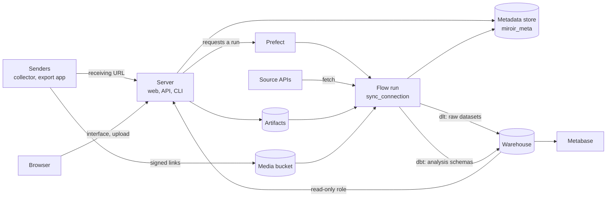

# Miroir

Miroir mirrors personal sources into one Postgres warehouse and keeps them there
for good. Connections are created in a web interface, each load runs as a
Prefect flow run, dlt loads the rows, and analyses build dbt models on top for
Metabase and for Miroir's own timeline. The server, the HTTP API and the CLI
call the same services. Why it exists and how it fits with the other systems:
the handbook's [Warehouse](https://github.com/h-wb/handbook/blob/main/Systems/Warehouse.md).
How it is deployed:
[home-ops](https://github.com/h-wb/home-ops/blob/main/kubernetes/apps/main/automation/miroir/README.md).

| Page | What it holds |
| --- | --- |
| [Configuration](configuration.md) | `miroir.json`, the environment, credentials |
| [Connections and runs](runs.md) | How data arrives, how a load runs, Prefect, analysis builds, the metadata schema |
| [Analyses](analyses.md) | The packages, what each builds, the messages and timeline tables |
| [Media](media.md) | Files that rows point at, thumbnails, `media_objects`, backfills |
| [Timeline](timeline.md) | The read-only access to the warehouse, its API, images, the Day view and search |
| [Interface and API](api.md) | Logins, every HTTP route, the content security policy |
| [Writing an integration](integrations.md) | How a connector is written and tested |
| [Decisions](decisions.md) | Why it is built this way, numbered |
| [Architecture](../architecture.md) | Which part of the code does what, and who may import whom |
| [The collector](../../collector/README.md) | The program that delivers device sources |

## The words

| Word | Means |
| --- | --- |
| Miroir | One installation: its configuration file, metadata store, warehouse, artifact folder and media bucket. Its ID prefixes generated names |
| Integration, or connector | Code for one kind of source: settings, credential fields, resources, inputs, media kinds, the analysis it recommends (`src/integrations/<name>/`) |
| Input | How a connector reads: a fetch (an API pull with the connection's credentials) or a file format (with typed import options) |
| Connection | One configured account or device source: an ID, an integration, settings, credential references, a binding, and optionally resources, a watched folder and a schedule |
| Binding | The connection's dlt pipeline and dataset names; generated unless given |
| Artifact | An original file as received, stored once by its SHA-256 and scoped to its connection |
| Import | Parsing and loading one artifact with a parser version and options |
| Operation, attempt | A requested or observed sync, import, build or derive run; each execution of it is an attempt, with ingestion and transformation outcomes recorded apart |
| Package | A group of dbt models with typed input roles, parameters, outputs and a version (`src/analyses/catalog.py`) |
| Analysis | A configured instance of a package: which connection fills each input, a time zone, parameters, dashboard links. It builds into schemas of its own |
| Media | Files rows point at, such as screenshots, kept in a bucket and never parsed |
| Sender | A program that pushes files to a connection's receiving URL: the phone's health export app, or the collector |
| Delivery token | A connection's receive-only token, for senders |



## The rules every part keeps

- Extract raw, interpret in dbt. A connector yields records as the source gives
  them; who is "me", bots, units, time zones and deduplication across sources
  are models.
- Merge, never append. Every resource has a primary key and merges, so loading a
  window or a file again changes nothing. Incremental cursors re-read a small
  overlap to catch late updates.
- Keep what sources forget. Merges never delete, so rows a service expires stay.
  Absence from a delivery deletes nothing.
- Unknown is not zero. An input that is not linked, or never loaded, gives null
  measures, never zeros and never another account's data.
- Status is a projection of records. Miroir records operations and attempts;
  Prefect keeps logs and run history, dlt keeps cursors and load packages. Miroir
  copies neither and never claims exactly-once.
- Identities persist. Connection IDs, bindings, resource and table names, keys
  and dlt state keys change only through an explicit migration.
- Capabilities are declared, not assumed: a connector says which inputs,
  resources and media it has. Destructive work (a rebuild from scratch, removing
  data) is always an explicit request.
- The configuration file is the desired state; every writer checks its revision
  before saving. The metadata store holds what was observed.
- One orchestrator. Schedules are configuration; Prefect runs them, on a cluster
  or on one machine. Miroir has no scheduler of its own.

It is built on Python, dlt, Prefect, Postgres, dbt and Metabase. Meltano was
tried in 2026-10 and not adopted: it would add a configuration and execution
layer without removing work, since dlt already owns state and merging.

## Commands

`pipelines-miroir` (or `python -m src.cli`) takes `--config` before the command
(default `miroir.json` in the current folder, gitignored). Output is JSON; exit
status 0 is success, 1 a failed run, 2 an invalid or unreadable configuration.
Commands that read the metadata store take `--metadata` (a SQLAlchemy URL;
default `$MIROIR_METADATA_URL`, then the composed `MIROIR_METADATA__*` parts,
then `sqlite:///.miroir/metadata.sqlite`).

| Command | Does | Page |
| --- | --- | --- |
| `integrations`, `validate`, `connections` | List connectors, check the configuration, list bindings; never fetch a credential or write anything | [Configuration](configuration.md) |
| `generate-key`, `set-credential`, `check`, `rotate-secrets` | Make a master key, store a credential, test a connection, re-encrypt | [Configuration](configuration.md#credentials) |
| `run`, `submit`, `import`, `artifacts`, `status`, `execute` | Load into a local DuckDB file, store a file, import it, list files, show status, run one request | [Connections and runs](runs.md#on-the-command-line) |
| `deployments plan`, `deployments apply`, `refresh` | Reconcile with Prefect | [Connections and runs](runs.md#prefect) |
| `analyses`, `models` | List analyses, rebuild one | [Analyses](analyses.md) |
| `media-backfill` | Thumbnails and records for files stored earlier | [Media](media.md#backfill) |
| `serve` | The interface and API | [Interface and API](api.md) |

## Develop it

```bash
mise run dev                 # http://127.0.0.1:8765
mise run dev -- --port 8766
```

This serves the checkout with its own empty configuration, SQLite metadata,
DuckDB warehouse, artifacts and master key under the gitignored `.miroir/dev/`.
The login token is in `.miroir/dev/api-token`; the key and token are reused
after a restart, in files of mode 600 in a folder of mode 700. It needs no
secret, ignores inherited Miroir, Prefect and Postgres settings, and cannot have
a Prefect deployment, so requests run as local subprocesses. Restart after a
code change. [`examples/miroir.json`](../../examples/miroir.json) is a synthetic
configuration to try the read-only commands on.

`mise run dev:infra` serves the checkout against the existing installation
instead: its metadata store, its configuration and artifacts at
`/miroir/data/miroir/` (or `--config` and `--artifacts`), its Prefect pool. It
receives only `MIROIR_METADATA__PASSWORD`, `MIROIR_SECRET_KEY`,
`PREFECT_API_URL` and `PREFECT_API_AUTH_STRING`, and stops before connecting if
a prerequisite is missing: the metadata settings, a configuration with
`deployment.work_pool`, the shared artifact folder mounted at the same path. Its
own login token is in `.miroir/dev-infra/api-token`. This is live access: startup
runs the metadata migrations, edits change the shared configuration, and
requests go to the installation's pool, where flow runs use the deployed image,
not the checkout. In Paseo, the service scripts `dev` and `infra` run these two
tasks on an assigned port.

The tests are in [AGENTS.md](../../AGENTS.md#run-test-lint). They use synthetic
inputs, intercepted HTTP and temporary destinations: real dlt loads into DuckDB,
disposable Postgres clusters for the models, the timeline and the derive run,
and a real temporary Prefect API for the adapter. The runner's tests use SQLite,
so Postgres advisory locks are not covered.
