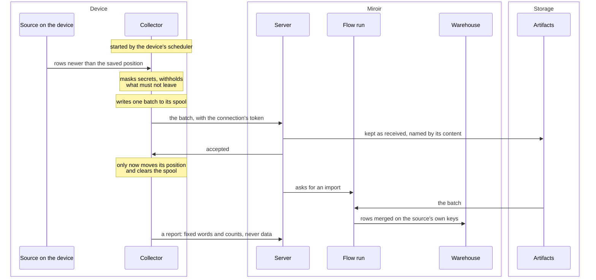
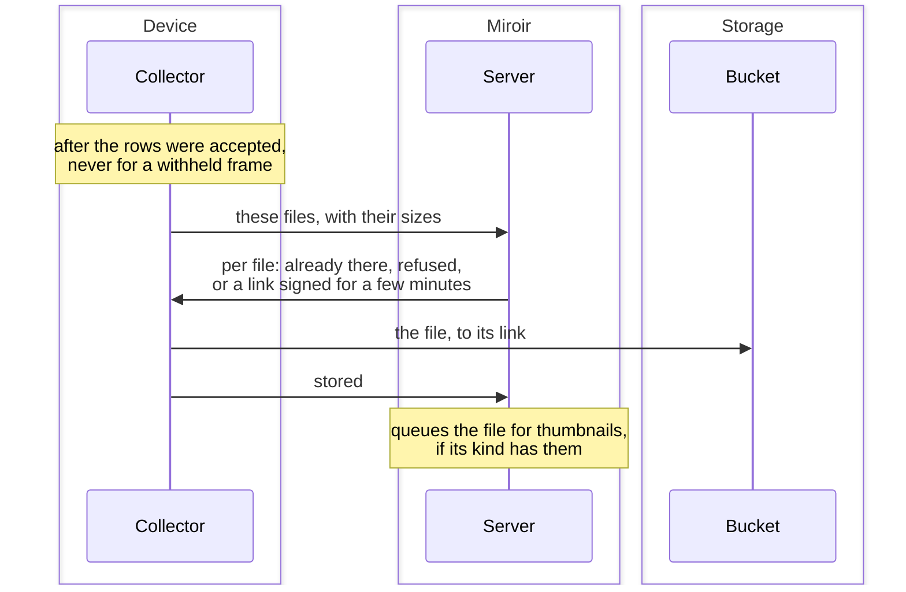
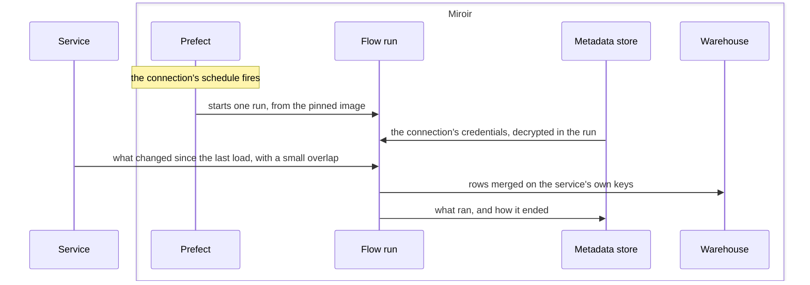
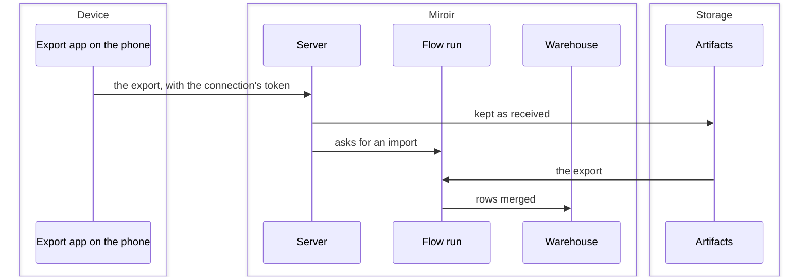
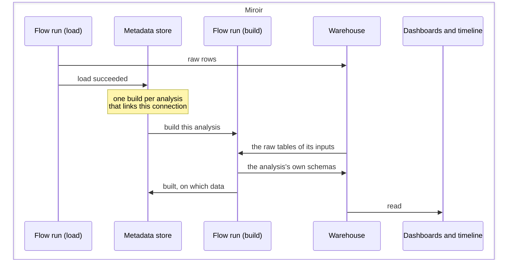
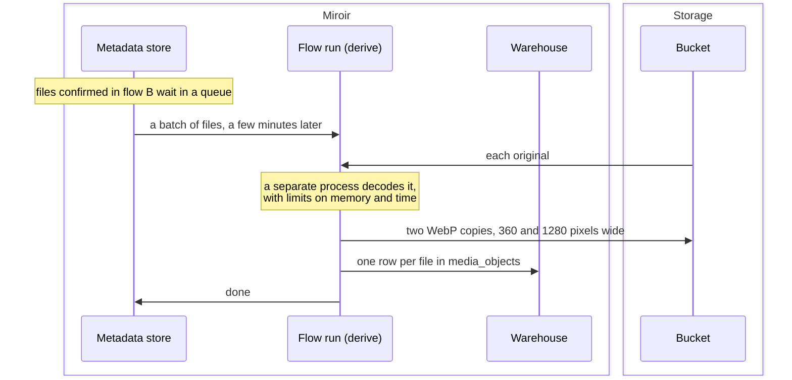
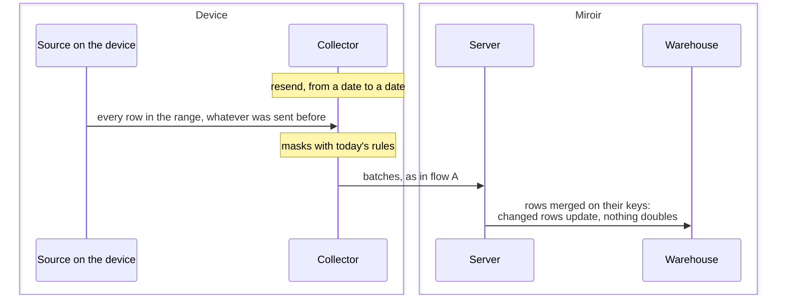
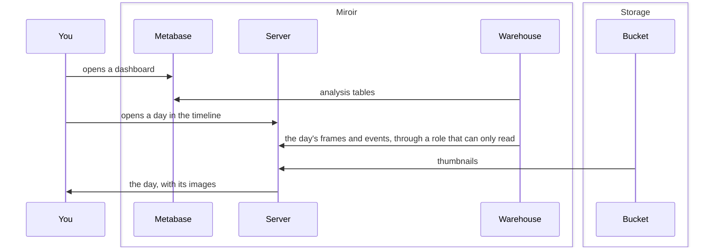

# Flows

How data moves into and out of the warehouse. The rules behind each flow are
[decisions](decisions.md), named here by number; the details of each step are on
[Connections and runs](runs.md), [Media](media.md) and [Timeline](timeline.md).
Which part of the code does what: [architecture](../architecture.md). Where each
part runs in the installation:
[home-ops](https://github.com/h-wb/home-ops/blob/main/kubernetes/apps/main/automation/miroir/README.md).

Every diagram uses the same columns in the same order: the device on the left,
Miroir in the middle (the server, Prefect, flow runs, the metadata store, the
warehouse), storage on the right (the artifact folder and the media bucket). A
flow shows only the columns it uses. An arrow shows where information moves.

There are two ways in (decision 021): a fetch, where Miroir pulls from a
service's API, and a delivered file, which reaches a connection by upload, its
receiving URL or a watched folder and is kept as an artifact before it is
imported. A sender, such as the collector or the phone's export app, is a client
of the receiving URL, not a transport of its own.

## A. A device delivers rows

The collector reads what is new in a local source, removes what must not leave,
and hands one file to Miroir. Screen text, browser history and messages arrive
this way (decisions 030, 032, 034, 038).

The source is opened read-only, and the collector sends rows as they are: no
cleaning, no joining, no summary. Masking is the one change it makes, by fixed
rules and a pinned scanner, never by a model.

- What guarantees it: the position moves only after Miroir answers 200 or 201,
  so a batch that did not arrive is sent again by the next run. The same bytes
  are the same artifact and rows merge on keys, so a batch that arrives twice
  changes nothing. A token can only add to its own connection.
- What it costs: the warehouse is as far behind as the device's schedule. A
  masked value is gone from the warehouse for good; a better rule means sending
  that range again (flow G) while the source still holds it. Each delivery
  requests one import.

## B. A file that a row points at

A frame has a screenshot and a message has attachments. Those files are not
parsed, so they skip flow A and go straight to the bucket (decision 033).

The file's name in the bucket comes from a column of its row, so row and file
are tied by construction and need no lookup table.

- What guarantees it: the device never holds a storage key. A link is good for
  one file and a few minutes. A file already there is not sent again, so an
  interrupted upload resumes where it stopped.
- What it costs: a screenshot cannot be masked. The bucket is private and
  viewing a file needs Miroir's login. A file that is not on the device (an
  attachment still in the cloud) is missing until it is.

## C. A service is fetched

For a service with an API nothing runs on a device. Prefect starts a load on the
connection's schedule, or when one is requested (decisions 012, 013, 021).

- What guarantees it: reading an overlap again is harmless, because rows merge.
  One load at a time per connection.
- What it costs: a service that expires data faster than the schedule runs
  loses rows.

## D. An app pushes an export

The phone's health export app posts each export to the connection's receiving
URL: flow A without a collector, through the same door, with the same token rule
and the same import (decision 017).

A file can also be uploaded in the interface or left in a watched folder. All
three ways register the file first and import it second, so any file can be
imported again later with a newer parser.

## E. From a load to tables you read

Raw tables mirror the source. Everything that interprets them (who is "me", local
days, sessions, counts) is a model in an analysis, built after each load
(decisions 022, 040, 042).

- What guarantees it: an analysis writes only into its own schemas, so two never
  collide. A failed build leaves the load succeeded and the analysis stale.
  Builds run one at a time.
- What it costs: a busy source would build constantly, so `messages` and
  `timeline` build at most every ten and five minutes, and loads inside that
  window share one build. A model that changes shape needs a rebuild from
  scratch.

## F. Thumbnails

Scrubbing through a day needs small images. A derive run makes them once, a few
minutes after files arrive (decision 040).

`media_objects` is how a model knows whether a file exists and has thumbnails,
without asking the bucket. Files stored before thumbnails existed are walked by
`media-backfill`.

- What guarantees it: the decoder proves itself on built-in images before it
  touches a file, so a broken decoder stops the run instead of marking files
  failed. One bad file costs one row, not the batch.
- What it costs: only screenshots are derived. Attachments get neither
  thumbnails nor records, and no thumbnail is made of HEIC or video.

## G. Sending something again

A restore, a second Mac with the same messages, a new masking rule, a gap to
repair: all are flow A, started by hand for a range of dates (decisions 034,
038).

- What guarantees it: ScreenMemory and Messages rows are keyed by the source's
  own identifiers (a frame's image path, Apple's guids), so the same thing from
  two devices or two backups is one row. Browser rows are keyed by the profile's
  own row IDs, so a second profile needs a connection of its own.
- What it costs: it works only while the source still holds the range. The
  saved position does not move.

## H. Reading

Two readers, one rule: read analyses, not raw tables.

| Reader | Reads |
| --- | --- |
| Dashboards | Analysis schemas |
| Timeline | The `timeline` analysis (screen and browser) and thumbnails |

- What guarantees it: the timeline's role can read only the timeline's tables,
  and every query stops after five seconds. Images are served behind Miroir's
  login.
- What it costs: a dashboard is as fresh as the last build, not the last load.
